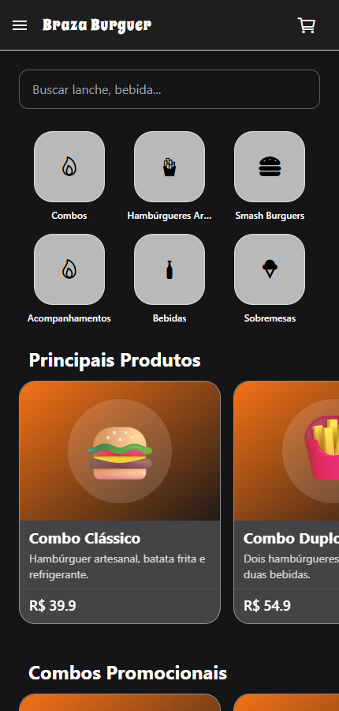
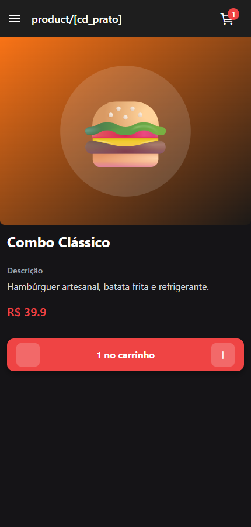
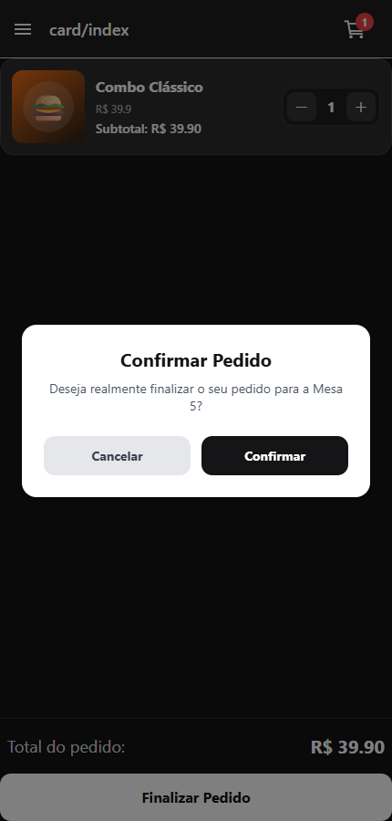

<h1 align="center">🍔 Hamburgueria</h1>

<p align="center"><em>Cardápio digital por QR Code: o cliente escolhe os pratos na mesa e o pedido segue direto para a cozinha.</em></p>

<p align="center">
  <a href="#-sobre">Sobre</a> · <a href="#-funcionalidades">Funcionalidades</a> · <a href="#-tecnologias">Tecnologias</a> · <a href="#-como-rodar">Como rodar</a> · <a href="#-contato">Contato</a>
</p>

<p align="center">
  
  
  
</p>

<p align="center">
  
  &nbsp;&nbsp;
  
  &nbsp;&nbsp;
  
</p>

<p align="center"><sub>Capturas feitas com uma API de teste e pratos fictícios.</sub></p>

---

## 💻 Sobre

Aplicativo (Expo / React Native, roda no celular e na web) para uma hamburgueria. O cliente lê o QR Code da mesa, monta o carrinho e finaliza o pedido. O back-end grava no PostgreSQL e avisa a cozinha em tempo real por WebSocket.

> **Tipo:** projeto de estudo · **Ano:** 2026

## ✨ Funcionalidades

- Identificação da mesa por QR Code ou digitando o número.
- Cardápio com busca, categorias e destaques.
- Página do prato e carrinho com quantidades e total.
- Envio do pedido (`POST /pedidos`) com os itens da mesa.
- Back-end que avisa novos pedidos e mudanças de status por Socket.IO.

## 🎯 Dores que resolve

- Cliente esperando o garçom só para ver o cardápio ou fazer o pedido.
- Pedido anotado errado ou perdido no caminho até a cozinha.
- Cozinha sem uma visão única dos pedidos abertos.

## 💼 Tecnologias


| Tecnologia | Para que usei |
| --- | --- |
| **Expo + expo-router** | App com navegação por arquivos, no celular e na web. |
| **NativeWind** | Estilo com classes Tailwind no React Native. |
| **expo-camera** | Leitura do QR Code da mesa. |
| **Express + TypeScript** | API REST em camadas (rota, serviço, repositório). |
| **Socket.IO** | Avisos em tempo real de pedidos. |
| **PostgreSQL (`pg`)** | Pedidos, itens e cardápio. |

## 🚀 Como rodar

**Back-end** (`BACK-END/`): crie um `.env` com `DB_HOST`, `DB_PORT`, `DB_NAME`, `DB_USER`, `DB_PASSWORD` e `API_PORT`.

```bash
cd BACK-END
npm install
npm run dev
```

**Aplicativo** (`FRONT-END/`): aponte `EXPO_PUBLIC_API_URL` para a API (veja `.env`).

```bash
cd FRONT-END
npm install
npm run web        # ou: npm start (Expo Go / emulador)
```

## 🗂 Estrutura do projeto

```text
BACK-END/    API Express: rotas, serviços, repositórios e sockets
FRONT-END/   aplicativo Expo / React Native
docs/        capturas de tela
```

## 🧭 Próximos passos

- [ ] Tela da cozinha com os pedidos abertos e botões de status
- [ ] Listar pedidos abertos na API (`GET /pedidos`)
- [ ] Gravar pedido e itens numa única transação
- [ ] Script das tabelas do banco e `.env.example` do back-end

## 📬 Contato

Disponível para freelas e novas oportunidades, **#OpenToWork** 🚀  
📧 [murilorochadelima.10@gmail.com](mailto:murilorochadelima.10@gmail.com) · 💼 [LinkedIn](https://www.linkedin.com/in/murilo-rocha-6706a41aa/) · 🐙 [GitHub](https://github.com/MuriloRocha-01) · 🌐 [Portfólio](https://oficial-portifolio-six.vercel.app)

---

<p align="center">Feito com 💙 por <a href="https://github.com/MuriloRocha-01">Murilo Rocha</a></p>
